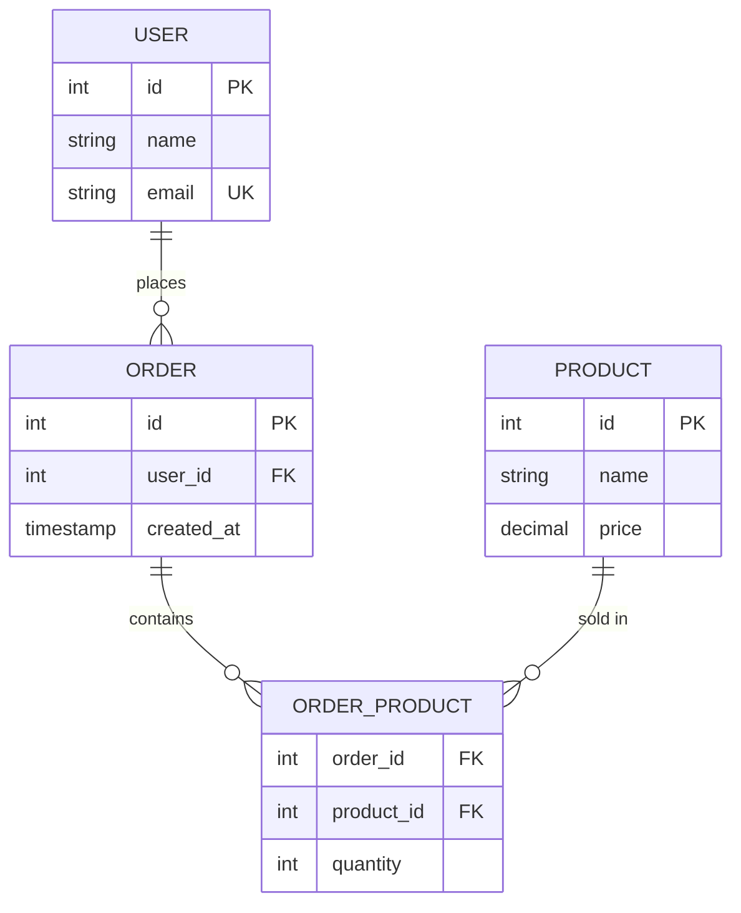
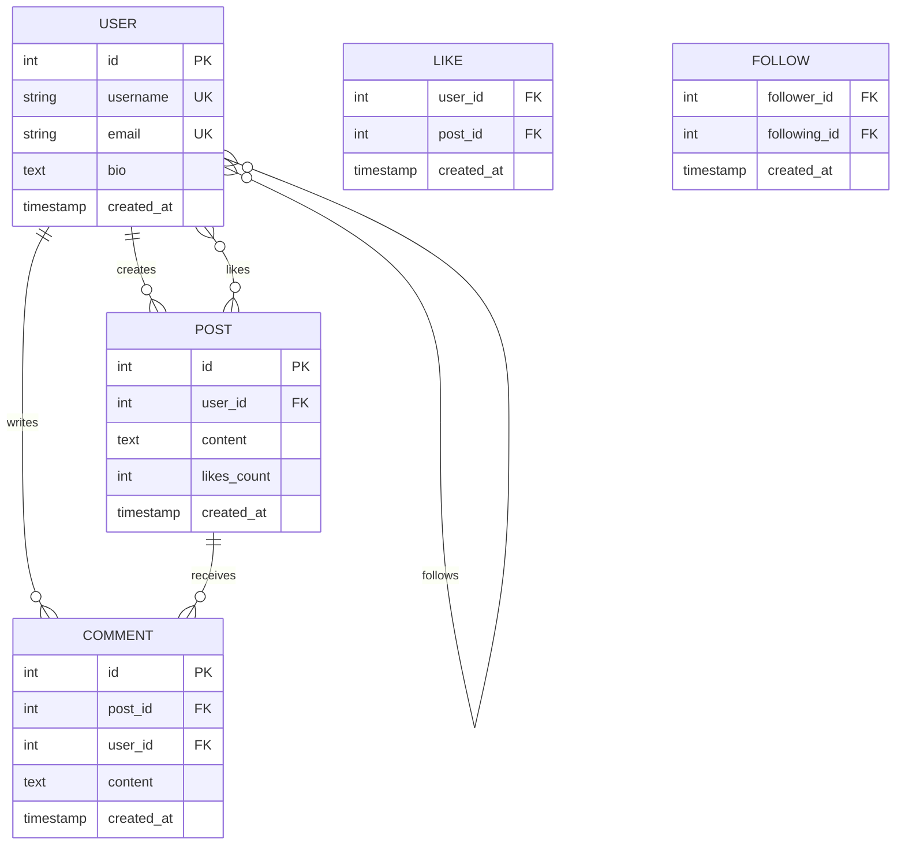
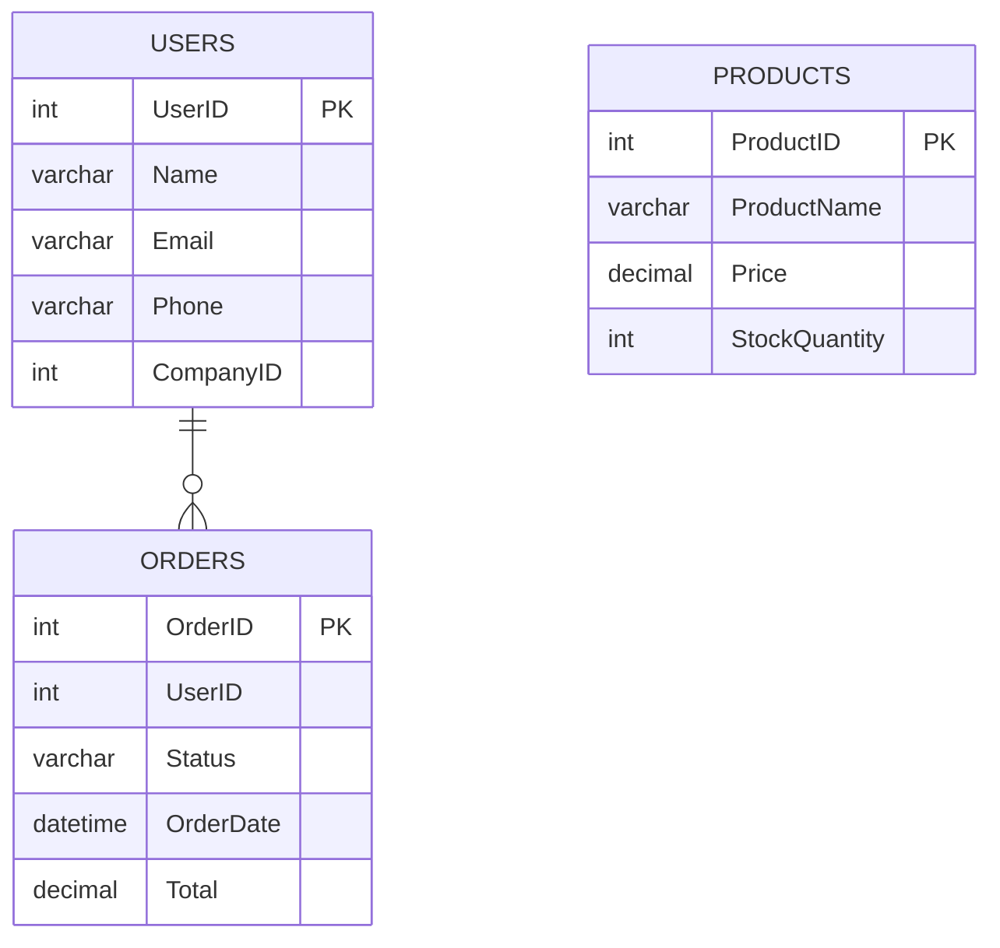
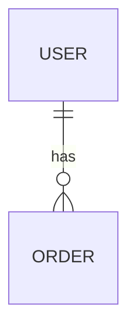
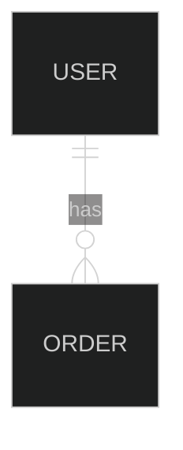
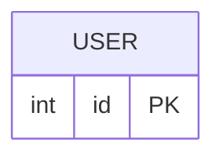
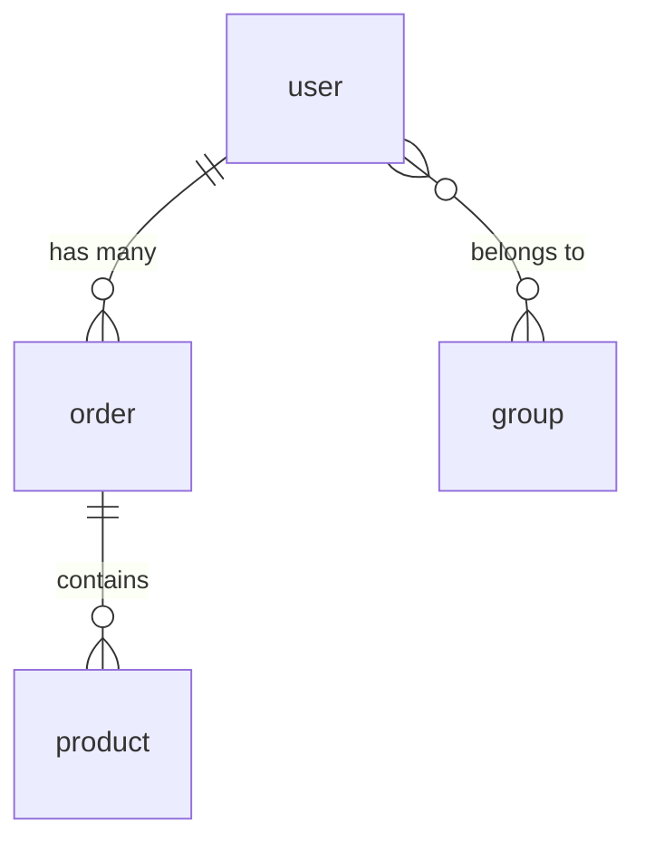

# Mermaid para Diagramas ER - Guía Paso a Paso

Cómo crear diagramas Entidad-Relación profesionales con Mermaid e integrarlos con Claude.

---

## Parte 1: Conceptos Básicos

### ¿Qué es Mermaid?

Lenguaje de diagrama basado en texto que genera SVG/PNG.

**Ventajas:**
- No requiere software (solo texto)
- Versionable en Git
- Generación automática
- Actualización rápida
- Integrable en Markdown

### Sintaxis básica de ER Mermaid

```
erDiagram
    TABLA ||--o{ OTRA_TABLA : relación
```

**Componentes:**

```
erDiagram
    |     = Cardinalidad (uno)
    o     = Cero
    {     = Muchos
    --    = Relación
```

---

## Parte 2: Cardinalidad (Relaciones)

### Símbolos de cardinalidad

```
|o  = Cero o uno
||  = Exactamente uno
o{  = Cero a muchos
|{  = Uno a muchos
}{  = Muchos a muchos
```

### Ejemplos de cada tipo

#### 1:1 (Usuario tiene 1 Perfil)
```
USER ||--|| PROFILE : has
```

#### 1:N (Usuario tiene muchas Órdenes)
```
USER ||--o{ ORDER : "has many"
```

#### N:M (Productos en muchos Pedidos)
```
PRODUCT }o--o{ ORDER : "belongs to many"
```

#### 0:N (Comentario opcional)
```
USER o|--o{ COMMENT : "may have"
```

---

## Parte 3: Crear tu primer diagrama ER

### Paso 1: Definir entidades

```
erDiagram
    USER
    ORDER
    PRODUCT
```

### Paso 2: Agregar atributos

```
erDiagram
    USER {
        int id
        string name
        string email
    }
    ORDER {
        int id
        int user_id
        decimal total
    }
    PRODUCT {
        int id
        string name
        decimal price
    }
```

### Paso 3: Definir relaciones

```
erDiagram
    USER ||--o{ ORDER : "has many"
    ORDER ||--o{ PRODUCT : "contains"
```

### Paso 4: Combinado (Ejemplo completo)

```
erDiagram
    USER {
        int id PK
        string name
        string email UK
        timestamp created_at
    }
    ORDER {
        int id PK
        int user_id FK
        decimal total
        timestamp created_at
    }
    PRODUCT {
        int id PK
        string name
        decimal price
    }
    ORDER_PRODUCT {
        int order_id FK
        int product_id FK
        int quantity
    }
    
    USER ||--o{ ORDER : "has many"
    ORDER ||--o{ ORDER_PRODUCT : "contains"
    PRODUCT ||--o{ ORDER_PRODUCT : "included in"
```

### Resultado visual:

```
┌─────────────────────────┐
│         USER            │
├─────────────────────────┤
│ id (PK)                 │
│ name                    │
│ email (UK)              │
│ created_at              │
└─────────────────────────┘
           │
           │ ||--o{
           │ "has many"
           ▼
┌─────────────────────────┐
│        ORDER            │
├─────────────────────────┤
│ id (PK)                 │
│ user_id (FK)            │
│ total                   │
│ created_at              │
└─────────────────────────┘
           │
           │ ||--o{
           │ "contains"
           ▼
┌─────────────────────────┐
│   ORDER_PRODUCT         │
├─────────────────────────┤
│ order_id (FK)           │
│ product_id (FK)         │
│ quantity                │
└─────────────────────────┘
           │
           │ ||--o{
           └──────→ PRODUCT
```

---

## Parte 4: Atributos y Anotaciones

### Tipos de datos soportados

```
erDiagram
    TABLA {
        int id                  "Entero"
        string name             "Texto (varchar)"
        decimal price           "Decimal (money)"
        boolean is_active       "Booleano"
        datetime created_at     "Fecha y hora"
        text description        "Texto largo"
        float rating            "Número decimal"
    }
```

### Anotaciones especiales

```
erDiagram
    USER {
        int id PK               "Primary Key"
        string email UK         "Unique Key"
        int role_id FK          "Foreign Key"
        string name NN          "Not Null"
        string phone            "Nullable"
    }
```

**Abreviaturas:**
- `PK` = Primary Key
- `FK` = Foreign Key
- `UK` = Unique Key
- `NN` = Not Null

---

## Parte 5: Ejemplo Real (BD de Fidelización - Summa Fidelidad)

### Paso a paso

```mermaid
erDiagram
    MERCHANT {
        int id PK
        string name NN
        string email UK
        string phone
        string city
        timestamp created_at
        timestamp deleted_at
    }
    
    CUSTOMER {
        int id PK
        int merchant_id FK
        string name NN
        string email UK
        decimal balance
        int points
        timestamp created_at
        timestamp updated_at
    }
    
    CARD {
        int id PK
        int customer_id FK
        string number UK
        string type
        boolean is_active
        timestamp created_at
        timestamp deleted_at
    }
    
    TRANSACTION {
        int id PK
        int card_id FK
        decimal amount NN
        string type
        string status
        timestamp created_at
    }
    
    REWARD {
        int id PK
        int merchant_id FK
        string name NN
        int points_required
        decimal discount_percent
        boolean is_active
        timestamp created_at
    }
    
    CUSTOMER_REWARD {
        int customer_id FK
        int reward_id FK
        timestamp redeemed_at
    }
    
    MERCHANT ||--o{ CUSTOMER : "has many"
    CUSTOMER ||--o{ CARD : "owns"
    CARD ||--o{ TRANSACTION : "generates"
    MERCHANT ||--o{ REWARD : "offers"
    CUSTOMER }o--o{ REWARD : "can redeem"
```

**Explicación:**

1. **MERCHANT** (Negocio)
   - PK: id
   - Atributos: nombre, email, teléfono, ciudad
   - Auditoría: created_at, deleted_at (soft delete)

2. **CUSTOMER** (Cliente)
   - PK: id
   - FK: merchant_id (1:N a MERCHANT)
   - Datos: nombre, email, balance, puntos

3. **CARD** (Tarjeta de fidelización)
   - PK: id
   - FK: customer_id (1:N a CUSTOMER)
   - Auditoría: deleted_at (para desactivar sin perder datos)

4. **TRANSACTION** (Transacción)
   - PK: id
   - FK: card_id (1:N a CARD)
   - Datos: monto, tipo, estado

5. **REWARD** (Recompensa)
   - PK: id
   - FK: merchant_id (1:N a MERCHANT)
   - Datos: nombre, puntos requeridos, descuento

6. **CUSTOMER_REWARD** (Tabla junction para N:M)
   - FK: customer_id + reward_id (compuesta)
   - Auditoría: redeemed_at (cuándo se redimió)

**Relaciones:**
- MERCHANT → CUSTOMER (1:N)
- CUSTOMER → CARD (1:N)
- CARD → TRANSACTION (1:N)
- MERCHANT → REWARD (1:N)
- CUSTOMER ↔ REWARD (N:M vía CUSTOMER_REWARD)

---

## Parte 6: Cómo generar el diagrama en Claude

### Opción 1: Usar show_widget en Chat (Lo que haré a continuación)

Yo puedo generar el diagrama en vivo cuando le pidas. Solo necesitas escribir:

> Genera un diagrama ER para [tu BD] usando Mermaid

### Opción 2: Copiar-pegar en herramienta online

1. Ir a https://mermaid.live
2. Copiar código Mermaid completo
3. Ver preview en tiempo real
4. Descargar como SVG/PNG

### Opción 3: Integrar en tu documentación Markdown

```markdown
# Base de Datos de Summa Fidelidad

```mermaid
erDiagram
    MERCHANT ||--o{ CUSTOMER : "has many"
    ...
```
```

**En GitHub/GitLab:** Se renderiza automáticamente ✨

### Opción 4: Generar automáticamente desde SQL

Herramienta Python para convertir schema MySQL a Mermaid:

```bash
# Instalar
pip install mysql2mermaid

# Usar
mysql2mermaid -h localhost -u root -p password database_name > diagram.mmd
```

---

## Parte 7: Ejemplos de diferentes tipos de BD

### Ejemplo 1: BD simple (E-commerce)



### Ejemplo 2: BD compleja (Red social)



### Ejemplo 3: BD heredada con problemas (Antes de migración)



**Problemas identificados:**
- ❌ Sin convención (UserID vs id)
- ❌ Sin FK explícito
- ❌ Sin auditoría (created_at, updated_at)
- ❌ Sin soft delete
- ❌ Sin índices documentados

### Ejemplo 4: BD después de mejora

```mermaid
erDiagram
    user {
        int id PK
        string name NN
        string email UK
        string phone
        timestamp created_at
        timestamp updated_at
        timestamp deleted_at
    }
    "order" {
        int id PK
        int user_id FK
        string status NN
        timestamp created_at
        timestamp updated_at
    }
    product {
        int id PK
        string name NN
        decimal price
        int stock_quantity
        timestamp created_at
        timestamp updated_at
        timestamp deleted_at
    }
    order_product {
        int order_id FK
        int product_id FK
        int quantity NN
    }
    
    user ||--o{ "order" : "has"
    "order" ||--o{ order_product : "contains"
    product ||--o{ order_product : "in"
```

**Mejoras aplicadas:**
- ✅ snake_case
- ✅ Auditoría en todas las tablas
- ✅ Soft delete (deleted_at)
- ✅ PK/FK explícitos
- ✅ NN donde corresponda
- ✅ UK en email

---

## Parte 8: Colores y estilos personalizados

Mermaid soporta temas y personalizaciones.

### Tema predeterminado



### Tema oscuro



### Con colores personalizados



---

## Parte 9: Exportar diagrama

### Desde mermaid.live

1. Crear diagrama
2. Click en "Download"
3. Opciones:
   - **SVG** (recomendado, escalable)
   - **PNG** (rápido, fijo)
   - **Markdown** (copiar-pegar)

### Desde línea de comandos

```bash
# Instalar
npm install -g @mermaid-js/mermaid-cli

# Generar SVG
mmdc -i diagram.mmd -o diagram.svg

# Generar PNG
mmdc -i diagram.mmd -o diagram.png -e png
```

### Integrar en documentación

```markdown
# Diagrama de la BD


O incluir código:

\`\`\`mermaid
erDiagram
    USER ||--o{ ORDER : "has"
\`\`\`
```

---

## Parte 10: Checklist para diagramas ER

- [ ] Todas las tablas tienen `id` PK?
- [ ] Todas las FK están etiquetadas?
- [ ] Todas las relaciones tienen cardinalidad correcta?
- [ ] Se usan convenciones (snake_case, singular)?
- [ ] Se documenta auditoría (created_at, updated_at)?
- [ ] Soft delete (deleted_at) donde corresponda?
- [ ] Atributos NN/UK marcados?
- [ ] Tablas junction para N:M?
- [ ] Diagrama es legible (no más de 10-12 tablas por diagrama)?
- [ ] Se exportó en SVG para documentación?

---

## Parte 11: Troubleshooting

### Problema: Relación no aparece
```mermaid
erDiagram
    A ||--o{ B : "relation"  ✅ Correcto
    A -- B                    ❌ Falta cardinalidad
```

### Problema: Nombre de tabla con espacios
```mermaid
erDiagram
    "USER ORDER" {          ✅ Usar comillas
        int id
    }
```

### Problema: Símbolo de llave extraño
```
||--o{  ✅ Correcto
||--||  ✅ Correcto
}o--o{  ✅ Correcto
```

### Problema: Muchas tablas = diagrama ilegible

**Solución:** Crear múltiples diagramas por dominio

```
# Diagrama 1: Usuarios y autenticación
USER, ROLE, PERMISSION

# Diagrama 2: Órdenes y productos
ORDER, PRODUCT, ORDER_PRODUCT

# Diagrama 3: Pagos y facturación
PAYMENT, INVOICE
```

---

## Parte 12: Comparación visual: Antes vs Después

### Antes (SQL plain)

```sql
CREATE TABLE user (
    id INT PRIMARY KEY AUTO_INCREMENT,
    name VARCHAR(100),
    email VARCHAR(100) UNIQUE,
    created_at TIMESTAMP DEFAULT CURRENT_TIMESTAMP
);

CREATE TABLE order (
    id INT PRIMARY KEY AUTO_INCREMENT,
    user_id INT,
    total DECIMAL(10,2),
    FOREIGN KEY (user_id) REFERENCES user(id)
);
```

**Problemas:**
- ❌ No visual
- ❌ Relaciones no claras
- ❌ Difícil de presentar

### Después (Mermaid)

```mermaid
erDiagram
    user {
        int id PK
        string name NN
        string email UK
        timestamp created_at
    }
    "order" {
        int id PK
        int user_id FK
        decimal total
    }
    user ||--o{ "order" : "has many"
```

**Ventajas:**
- ✅ Visual e inmediato
- ✅ Relaciones claras
- ✅ Profesional
- ✅ Fácil de actualizar

---

## Parte 13: Integración con tus scripts de migración

En `SCRIPTS.md`, puedes incluir:

```bash
#!/bin/bash
# generate-er-diagram.sh

DB_NAME="$1"

# Extraer estructura MySQL
mysql -u root -p "$DB_NAME" -e "
    SELECT TABLE_NAME, COLUMN_NAME, COLUMN_TYPE, 
           IF(COLUMN_KEY='PRI', 'PK', IF(COLUMN_KEY='UNI', 'UK', '')) as key_type
    FROM information_schema.COLUMNS 
    WHERE TABLE_SCHEMA = '$DB_NAME'
    ORDER BY TABLE_NAME, ORDINAL_POSITION;
" > schema.txt

# Generar Mermaid (semiautomático, requiere post-procesamiento)
echo "erDiagram" > diagram.mmd
cat schema.txt | awk '{print "    " $1 " { " $2 " " tolower($3) " " $4 " }"}' >> diagram.mmd

# Generar SVG
mmdc -i diagram.mmd -o diagram.svg

echo "✅ Diagrama generado: diagram.svg"
```

---

## Resumen: Cheat Sheet



**Cardinalidad rápida:**
```
||    = Exactamente 1
|o    = 0 o 1
|{    = 1 a muchos
}{    = Muchos a muchos
o{    = 0 a muchos
```

**Anotaciones:**
```
PK    = Primary Key
FK    = Foreign Key
UK    = Unique
NN    = Not Null
```

**Crear tabla:**
```
entidad {
    tipo nombre PK
    tipo nombre UK
    tipo nombre NN
    tipo nombre
}
```
